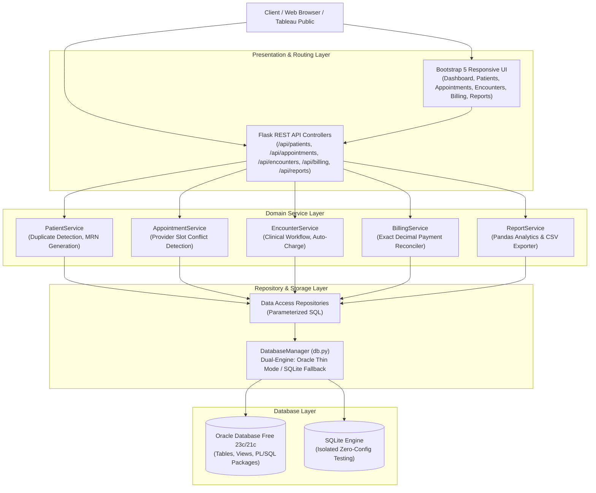
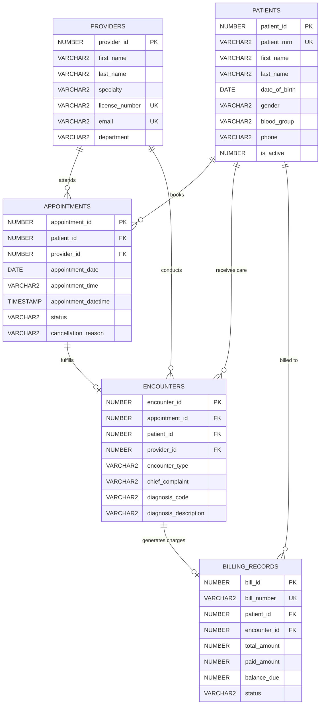

# Healthcare Data Management and Analytics System (HealthPulse)

[](https://www.python.org/)
[](https://flask.palletsprojects.com/)
[](https://www.oracle.com/database/free/)
[](https://pytest.org/)
[](LICENSE)

An enterprise-grade, end-to-end healthcare data management and analytics platform simulating authentic hospital operations. The system orchestrates patient registration, physician scheduling, provider slot conflict prevention, clinical documentation (SOAP progress notes & ICD-10 coding), and accounts receivable billing with IEEE 754-safe exact decimal arithmetic.

---

## 1. System Architecture

HealthPulse implements a clean, decoupled layered architecture separating HTTP routing, domain business logic, data access repositories, and database storage engines.



---

## 2. Technology Stack

- **Backend Framework:** Python 3.12, Flask 3.0
- **Database Engine:** Oracle Database Free (23c / 21c) via `python-oracledb` (Thin Mode, zero Oracle Instant Client requirement), with SQLite for zero-configuration testing.
- **Database Programming:** ANSI SQL, Oracle SQL DDL/DML, PL/SQL Procedures, Functions, and Packages (`PKG_HEALTHCARE_REPORTING`).
- **Data Analysis & Transformation:** Pandas 2.1+
- **Business Intelligence & Dashboards:** Tableau Public / Tableau Desktop
- **Testing & Quality Assurance:** Pytest 8.2 (55 automated tests passing with 100% pass rate)
- **Frontend Interface:** HTML5, CSS3, JavaScript (ES6+), Bootstrap 5.3, FontAwesome 6, Chart.js 4.4
- **Version Control:** Git & GitHub

---

## 3. Core Functional Modules

### Module 1: Patient Management
- Unique Medical Record Number generation (`MRN-10001` through `MRN-10025`).
- Demographic intake: Date of birth (future dates disallowed), biological gender validation, phone, email, and emergency contact details.
- Active state management with soft-delete capabilities.
- Search indexing across patient name, MRN, and telephone.

### Module 2: Appointment Management
- Scheduling and calendar slot reservation.
- **Provider Conflict Prevention:** Automated validation against overlapping physician bookings using composite constraints `(provider_id, appointment_datetime)`.
- Controlled cancellation workflow requiring mandatory audit cancellation reasons.
- Status tracking across `SCHEDULED`, `CONFIRMED`, `COMPLETED`, `CANCELLED`, and `NO_SHOW`.

### Module 3: Clinical Encounter Documentation
- Clinician progress note recording (SOAP methodology).
- Standardized diagnostic coding via ICD-10 (e.g., `I10` Essential Hypertension, `E11.9` Type 2 Diabetes, `M54.5` Low Back Pain).
- Transactional synchronization: Recording an encounter automatically marks the associated appointment as `COMPLETED` and issues an initial billing charge.

### Module 4: Billing & Revenue Cycle Management
- Exact financial calculations using Python's `decimal.Decimal` quantized to two decimal places, eliminating IEEE 754 floating-point drift.
- Payment processing: Overpayment prevention (`payment <= balance_due`), updating status to `PAID` or `PARTIALLY_PAID`.
- Accounts receivable aging analysis categorizing balances into `Current`, `1-30 Days`, `31-60 Days`, `61-90 Days`, and `90+ Days Overdue`.

---

## 4. Normalized Relational Schema



Detailed schema specifications and constraints can be reviewed in [docs/database_design.md](docs/database_design.md).

---

## 5. SQL & PL/SQL Implementation

All database interactions use parameterized queries. The repository includes:

1. **`database/schema.sql`**: Full Oracle DDL with table creation, constraints, and indexes.
2. **`database/views.sql`**: 5 analytical views (`VW_PATIENT_CLINICAL_SUMMARY`, `VW_MONTHLY_BILLING_SUMMARY`, `VW_APPOINTMENT_ANALYTICS`, `VW_PROVIDER_WORKLOAD`, `VW_OUTSTANDING_BALANCES`).
3. **`database/functions.sql`**:
   - `FN_CALC_OUTSTANDING_BALANCE`: Returns total unpaid balance for a given patient.
   - `FN_VALIDATE_BILLING_AMOUNT`: Enforces monetary checks (`paid + balance == total`).
   - `FN_GET_PROVIDER_UTILIZATION`: Calculates provider slot utilization percentage.
4. **`database/procedures.sql`**:
   - `SP_CANCEL_APPOINTMENT`: Atomic appointment cancellation with audit logging.
   - `SP_RECORD_CLINICAL_ENCOUNTER`: Transaction linking encounter, appointment completion, and invoice generation.
   - `SP_PROCESS_BILLING_PAYMENT`: Applies payments with exact balance reduction.
5. **`database/packages.sql`**:
   - `PKG_HEALTHCARE_REPORTING`: Oracle PL/SQL package managing operational report cursors and revenue calculations.

---

## 6. The 5 Operational Reports

| # | Report Title | SQL Query File | Business Purpose | Output Fields |
| :- | :--- | :--- | :--- | :--- |
| **1** | **Monthly Billing Summary** | [reports/sql/monthly_billing.sql](reports/sql/monthly_billing.sql) | Track monthly collections, billing volume, and revenue realization rates. | `billing_month`, `total_bills`, `total_billed`, `total_collected`, `total_outstanding`, `collection_rate_pct`, `paid_count`, `pending_count`, `overdue_count` |
| **2** | **Appointment Status & Cancellation** | [reports/sql/appointment_status.sql](reports/sql/appointment_status.sql) | Analyze clinic booking retention and department cancellation rates. | `department`, `total_scheduled`, `completed_count`, `cancelled_count`, `no_show_count`, `cancellation_rate_pct`, `reasons` |
| **3** | **Longitudinal Patient Visit History** | [reports/sql/patient_visit_history.sql](reports/sql/patient_visit_history.sql) | Longitudinal timeline of patient encounters, diagnoses, doctors, and charges. | `patient_id`, `patient_mrn`, `encounter_date`, `encounter_type`, `attending_provider`, `diagnosis_code`, `bill_number`, `balance_due` |
| **4** | **Provider Appointment Utilization** | [reports/sql/provider_utilization.sql](reports/sql/provider_utilization.sql) | Evaluate clinician workload, completion efficiency, and billable revenue. | `provider_name`, `department`, `total_scheduled`, `completed_appointments`, `cancelled_appointments`, `unique_patients`, `completion_rate_pct`, `total_revenue` |
| **5** | **Outstanding Billing Aging Report** | [reports/sql/outstanding_billing.sql](reports/sql/outstanding_billing.sql) | Segment accounts receivable into 30, 60, and 90+ day aging buckets. | `bill_number`, `patient_name`, `patient_phone`, `due_date`, `total_amount`, `balance_due`, `days_overdue`, `aging_bucket` |

All reports are accessible via REST API (`/api/reports/*`) and exportable to CSV via Pandas.

---

## 7. Interactive Tableau Public Dashboard

Synthetic data from the database is exported to `tableau/exports/full_synthetic_dataset.csv`.

### Dashboard Visualizations Included:
1. **Monthly Patient Visit Trends**: Dual-axis line chart tracking scheduled appointments vs completed clinical encounters.
2. **Appointment Status Distribution**: Donut chart detailing appointment completion vs cancellation ratios.
3. **Department Cancellation Rates**: Horizontal bar chart comparing scheduling retention across departments.
4. **Monthly Billing Totals**: Triple-bar visualization comparing Total Billed, Collections, and Outstanding Receivables.
5. **Outstanding Accounts Receivable Aging**: Treemap and distribution cards segmenting overdue balances.
6. **Provider Utilization Efficiency**: Benchmark bullet chart comparing clinician utilization against the 80% hospital target.

For complete step-by-step instructions and calculated fields, refer to [tableau/README.md](tableau/README.md).

---

## 8. Automated Test Suite (Pytest)

The test suite contains **55 automated tests** covering unit validations, service business logic, API routing, and database constraint enforcement.

```bash
# Run the test suite
pytest tests -v
```

### Test Results Summary:
```
============================= test session starts =============================
platform win32 -- Python 3.12.4, pytest-8.2.2, pluggy-1.6.0
collected 55 items

tests/integration/test_api_endpoints.py::test_health_check_endpoint PASSED        [  1%]
tests/integration/test_api_endpoints.py::test_api_get_patients_paginated PASSED   [  3%]
tests/integration/test_api_endpoints.py::test_api_register_patient_success PASSED [  5%]
tests/integration/test_api_endpoints.py::test_api_register_patient_validation_error PASSED [  7%]
tests/integration/test_api_endpoints.py::test_api_get_patient_by_id PASSED       [  9%]
tests/integration/test_api_endpoints.py::test_api_get_patient_not_found PASSED   [ 10%]
tests/integration/test_api_endpoints.py::test_api_schedule_appointment_success PASSED [ 12%]
tests/integration/test_api_endpoints.py::test_api_schedule_appointment_conflict PASSED [ 14%]
tests/integration/test_api_endpoints.py::test_api_cancel_appointment PASSED      [ 16%]
tests/integration/test_api_endpoints.py::test_api_record_clinical_encounter PASSED [ 18%]
tests/integration/test_api_endpoints.py::test_api_billing_payment PASSED         [ 20%]
tests/integration/test_api_endpoints.py::test_api_report_monthly_billing PASSED  [ 21%]
tests/integration/test_api_endpoints.py::test_api_report_appointment_status PASSED [ 23%]
tests/integration/test_api_endpoints.py::test_api_report_provider_utilization PASSED [ 25%]
tests/integration/test_api_endpoints.py::test_api_report_outstanding_billing PASSED [ 27%]
tests/integration/test_api_endpoints.py::test_api_report_patient_visit_history PASSED [ 29%]
tests/integration/test_api_endpoints.py::test_api_dashboard_stats PASSED         [ 30%]
tests/integration/test_transactions_and_constraints.py::test_transaction_rollback_on_failure PASSED [ 32%]
tests/integration/test_transactions_and_constraints.py::test_unique_mrn_constraint_enforced PASSED [ 34%]
tests/integration/test_transactions_and_constraints.py::test_unique_provider_license_enforced PASSED [ 36%]
tests/integration/test_transactions_and_constraints.py::test_billing_negative_amount_constraint_enforced PASSED [ 38%]
tests/integration/test_transactions_and_constraints.py::test_billing_paid_exceeds_total_constraint_enforced PASSED [ 40%]
tests/unit/test_appointment_service.py::test_schedule_appointment_success PASSED [ 41%]
tests/unit/test_appointment_service.py::test_schedule_appointment_past_date_fails PASSED [ 43%]
tests/unit/test_appointment_service.py::test_schedule_conflicting_appointment_fails PASSED [ 45%]
tests/unit/test_appointment_service.py::test_cancel_appointment_success PASSED    [ 47%]
tests/unit/test_appointment_service.py::test_cancel_completed_appointment_fails PASSED [ 49%]
tests/unit/test_appointment_service.py::test_cancel_already_cancelled_appointment_fails PASSED [ 50%]
tests/unit/test_billing_service.py::test_create_bill_success PASSED               [ 52%]
tests/unit/test_billing_service.py::test_apply_payment_success PASSED             [ 54%]
tests/unit/test_billing_service.py::test_apply_overpayment_fails PASSED           [ 56%]
tests/unit/test_billing_service.py::test_apply_payment_to_fully_paid_bill_fails PASSED [ 58%]
tests/unit/test_billing_service.py::test_patient_outstanding_balance_calculation PASSED [ 60%]
tests/unit/test_decimal_utils.py::test_exact_decimal_conversion PASSED            [ 61%]
tests/unit/test_decimal_utils.py::test_no_float_precision_leak PASSED             [ 63%]
tests/unit/test_decimal_utils.py::test_calculate_balance PASSED                   [ 65%]
tests/unit/test_decimal_utils.py::test_validate_billing_math_valid PASSED          [ 67%]
tests/unit/test_decimal_utils.py::test_validate_billing_math_invalid_sum PASSED   [ 69%]
tests/unit/test_decimal_utils.py::test_validate_billing_math_negative_total PASSED [ 70%]
tests/unit/test_decimal_utils.py::test_validate_billing_math_paid_exceeds_total PASSED [ 72%]
tests/unit/test_decimal_utils.py::test_format_currency PASSED                     [ 74%]
tests/unit/test_patient_service.py::test_register_patient_service_success PASSED  [ 76%]
tests/unit/test_patient_service.py::test_register_patient_duplicate_email PASSED  [ 78%]
tests/unit/test_patient_service.py::test_get_nonexistent_patient_raises_404 PASSED [ 80%]
tests/unit/test_patient_service.py::test_update_patient_service PASSED            [ 81%]
tests/unit/test_patient_service.py::test_deactivate_patient_service PASSED        [ 83%]
tests/unit/test_validators.py::test_valid_patient_payload PASSED                  [ 85%]
tests/unit/test_validators.py::test_patient_future_dob_fails PASSED               [ 87%]
tests/unit/test_validators.py::test_patient_invalid_gender_fails PASSED           [ 89%]
tests/unit/test_validators.py::test_patient_invalid_email_fails PASSED            [ 90%]
tests/unit/test_appointment_validator_success PASSED                              [ 92%]
tests/unit/test_validators.py::test_appointment_invalid_time_fails PASSED        [ 94%]
tests/unit/test_validators.py::test_encounter_validator_success PASSED            [ 96%]
tests/unit/test_validators.py::test_billing_negative_amount_fails PASSED          [ 98%]
tests/unit/test_validators.py::test_payment_zero_amount_fails PASSED              [100%]

============================= 55 passed in 16.54s =============================
```

---

## 9. Setup & Quickstart Guide

### Prerequisites
- Python 3.10+ (tested on Python 3.12)
- Git
- Optional: Oracle Database Free 23c / 21c (if connecting to Oracle; otherwise SQLite mode is used automatically).

### Step 1: Clone Repository
```bash
git clone https://github.com/harsharaju1314-hash/Healthcare-Data-Management-and-Analytics-System.git
cd Healthcare-Data-Management-and-Analytics-System
```

### Step 2: Set Up Virtual Environment & Dependencies
```bash
python -m venv venv
# Windows:
.\venv\Scripts\activate
# Linux/macOS:
source venv/bin/activate

pip install -r requirements.txt
```

### Step 3: Configure Environment Variables
Copy `.env.example` to `.env`:
```bash
cp .env.example .env
```
To connect to an active Oracle Database Free instance, configure:
```ini
DB_ENGINE=oracle
ORACLE_USER=healthcare_admin
ORACLE_PASSWORD=your_password
ORACLE_HOST=localhost
ORACLE_PORT=1521
ORACLE_SERVICE_NAME=FREEPDB1
```
*Note: If Oracle credentials are not set or Oracle is unreachable, the system automatically runs on SQLite with zero configuration.*

### Step 4: Initialize Schema and Populate Seed Data
```bash
# Initialize tables, constraints, and indexes
python scripts/init_db.py

# Populate 8 Providers, 25 Patients, 29 Appointments, 22 Encounters, and 22 Billing Records
python scripts/seed_db.py

# Verify database health and record counts
python scripts/test_db_connection.py
```

### Step 5: Export Datasets for Tableau
```bash
python scripts/export_reports_to_csv.py
```

### Step 6: Run Tests
```bash
pytest tests -v
```

### Step 7: Launch the Application
```bash
python run.py --port 5000
```
Open your browser and navigate to:
- **Interactive UI Dashboard**: `http://localhost:5000`
- **Patient Directory**: `http://localhost:5000/patients`
- **Appointments Portal**: `http://localhost:5000/appointments`
- **Clinical Encounters**: `http://localhost:5000/encounters`
- **Billing & Invoices**: `http://localhost:5000/billing`
- **Operational Reports**: `http://localhost:5000/reports`
- **API Health Check**: `http://localhost:5000/api/health`

---

## 10. Project Directory Structure

```
Healthcare-Data-Management-and-Analytics-System/
├── app/
│   ├── __init__.py               # Flask application factory & error handlers
│   ├── routes/                   # REST API controllers & web views
│   │   ├── patients.py           # Patient CRUD & balance endpoints
│   │   ├── appointments.py       # Appointment booking & cancellation
│   │   ├── encounters.py         # Clinical progress notes & charge linkage
│   │   ├── billing.py            # Invoice management & decimal payments
│   │   ├── reports.py            # Operational report endpoints & CSV download
│   │   ├── dashboard.py          # KPI metrics
│   │   ├── providers.py          # Physician roster
│   │   └── system.py             # Health check & HTML templates routing
│   ├── services/                 # Domain business logic & validation rules
│   ├── repositories/             # Database access layer (Dual Oracle/SQLite)
│   ├── schemas/                  # Request payload validation schemas
│   ├── utils/                    # Decimal arithmetic, logging, response envelopes
│   ├── static/                   # CSS styling & Chart.js dashboard scripts
│   └── templates/                # Bootstrap 5 Jinja2 HTML templates
├── database/
│   ├── schema.sql                # Oracle DDL: Tables, constraints, indexes
│   ├── seed_data.sql             # Oracle synthetic seed records
│   ├── views.sql                 # Oracle analytical reporting views
│   ├── procedures.sql            # Oracle PL/SQL stored procedures
│   ├── functions.sql             # Oracle PL/SQL functions
│   └── packages.sql              # Oracle PL/SQL PKG_HEALTHCARE_REPORTING
├── reports/
│   ├── sql/                      # Standalone SQL queries for the 5 reports
│   └── exports/                  # Generated CSV reports
├── tableau/
│   ├── README.md                 # Step-by-step Tableau workbook guide
│   └── exports/                  # Tableau Public ready CSV datasets
├── tests/
│   ├── conftest.py               # Isolated in-memory database test harness
│   ├── unit/                     # Unit tests (validators, decimal math, services)
│   └── integration/              # Integration tests (APIs, constraints, transactions)
├── docs/
│   ├── database_design.md        # Relational ERD & data dictionary
│   ├── api_documentation.md      # REST API endpoints reference
│   ├── healthcare_workflows.md   # Patient-to-billing lifecycle & Millennium comparison
│   ├── root_cause_analysis.md    # 3 engineering defect investigations
│   └── ccl_comparison.md         # Cerner Command Language educational analysis
├── scripts/
│   ├── init_db.py                # Schema initialization
│   ├── seed_db.py                # Synthetic data seeder
│   ├── run_plsql.py              # PL/SQL object compiler for Oracle
│   ├── export_reports_to_csv.py  # Pandas CSV generator
│   └── test_db_connection.py     # Database diagnostic check
├── .env.example                  # Environment configuration template
├── .gitignore                    # Git exclusions
├── requirements.txt              # Python package requirements
├── config.py                     # Configuration loader
├── pytest.ini                    # Pytest configuration
├── run.py                        # Application entry point
└── README.md                     # Comprehensive project documentation
```

---

## 11. Security & Data Integrity

- **Synthetic Data Only**: All patient names, phone numbers, addresses, and diagnoses are fictional. No Protected Health Information (PHI) is stored or tracked.
- **Zero Hardcoded Secrets**: Database credentials and secret keys are loaded exclusively through environment variables.
- **SQL Injection Prevention**: All queries across repositories utilize strict parameterized binding.
- **Safe Error Responses**: API error handlers return sanitized messages without leaking raw database tracebacks, file system paths, or credential details.
