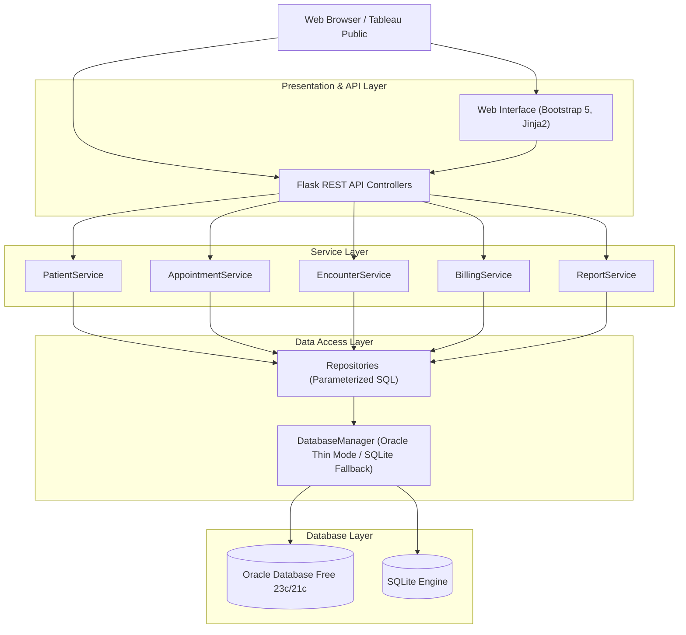

# Healthcare Data Management and Analytics System

A comprehensive healthcare data management and analytics application simulating hospital operational workflows. The system manages patient demographic records, provider scheduling, clinical documentation, and billing cycles, providing SQL-driven operational reports and Tableau analytics.

---

## 1. Architecture Overview

The application follows a layered design that separates presentation, business logic, data access, and storage.



---

## 2. Technology Stack

- **Backend:** Python 3.12, Flask 3.0
- **Database:** Oracle Database Free (23c / 21c) via `python-oracledb` (Thin Mode), with SQLite fallback for local testing
- **Database Programming:** SQL, PL/SQL (Procedures, Functions, Packages)
- **Data Analysis:** Pandas 2.1+
- **Business Intelligence:** Tableau Public
- **Testing:** Pytest 8.2 (55 automated tests)
- **Frontend:** HTML5, CSS3, JavaScript, Bootstrap 5.3, Chart.js

---

## 3. Core Functional Modules

### Module 1: Patient Management
- Patient registration with automatic Medical Record Number (`MRN-XXXXX`) generation.
- Demographic validation (date of birth verification, standardized gender, phone, email, emergency contact).
- Unique constraints on MRN and email to prevent duplicate registrations.
- Soft-deletion support (`is_active` flag) preserving historical medical integrity.

### Module 2: Appointment Management
- Appointment scheduling, status tracking (`SCHEDULED`, `CONFIRMED`, `COMPLETED`, `CANCELLED`, `NO_SHOW`).
- **Conflict Prevention:** Database-level composite constraint `(provider_id, appointment_datetime)` and application validation prevent overlapping bookings.
- Cancellation workflow requiring mandatory cancellation reasons; completed appointments cannot be cancelled.

### Module 3: Clinical Encounter Management
- Clinical documentation recording chief complaint, progress notes, and ICD-10 diagnostic codes.
- Transactional linkage: Recording an encounter automatically updates the appointment to `COMPLETED` and queues initial billing charges.

### Module 4: Billing Management
- Exact financial calculations using Python's `Decimal` type to prevent binary floating-point drift.
- Payment processing with overpayment checks (`payment_amount <= balance_due`).
- Automatic status transitions (`PENDING`, `PARTIALLY_PAID`, `PAID`, `OVERDUE`).
- Accounts receivable aging analysis across 30, 60, and 90+ day overdue brackets.

---

## 4. Database Schema Design

The schema is normalized to Third Normal Form (3NF) and consists of five core tables:

1. `PROVIDERS`: Physician roster, specialties, license numbers, and departments.
2. `PATIENTS`: Demographic data, contact details, and unique MRN.
3. `APPOINTMENTS`: Booking schedules, duration, status, and cancellation metadata.
4. `ENCOUNTERS`: Clinical observations, ICD-10 diagnoses, and physician SOAP notes.
5. `BILLING_RECORDS`: Invoices, charges, payments received, and outstanding balances.

### Key Constraints:
- Nonnegative check constraints on all monetary columns (`total_amount >= 0`, `paid_amount >= 0`, `balance_due >= 0`).
- Balance integrity rule: `paid_amount <= total_amount AND balance_due = total_amount - paid_amount`.
- Provider slot constraint: `UNIQUE (provider_id, appointment_datetime)`.

Complete schema documentation and data dictionaries are available in [docs/database_design.md](docs/database_design.md).

---

## 5. SQL & PL/SQL Objects

Database objects are organized in the `database/` directory:

- **`database/schema.sql`**: Table definitions, primary/foreign keys, check constraints, and performance indexes.
- **`database/views.sql`**: Analytical reporting views (`VW_PATIENT_CLINICAL_SUMMARY`, `VW_MONTHLY_BILLING_SUMMARY`, `VW_APPOINTMENT_ANALYTICS`, `VW_PROVIDER_WORKLOAD`, `VW_OUTSTANDING_BALANCES`).
- **`database/functions.sql`**: `FN_CALC_OUTSTANDING_BALANCE`, `FN_VALIDATE_BILLING_AMOUNT`, `FN_GET_PROVIDER_UTILIZATION`.
- **`database/procedures.sql`**: `SP_CANCEL_APPOINTMENT`, `SP_RECORD_CLINICAL_ENCOUNTER`, `SP_PROCESS_BILLING_PAYMENT`.
- **`database/packages.sql`**: `PKG_HEALTHCARE_REPORTING` (package specification and body for cursor-based operational reporting).

---

## 6. Operational Reports

Five SQL-driven operational reports address hospital administrative requirements:

| # | Report | SQL File | Objective |
| :- | :--- | :--- | :--- |
| **1** | **Monthly Billing Summary** | [reports/sql/monthly_billing.sql](reports/sql/monthly_billing.sql) | Summarizes monthly charges, collections, outstanding balances, and collection rates. |
| **2** | **Appointment Status & Cancellation** | [reports/sql/appointment_status.sql](reports/sql/appointment_status.sql) | Analyzes appointment volumes, cancellation rates, and cancellation reasons by department. |
| **3** | **Patient Visit History** | [reports/sql/patient_visit_history.sql](reports/sql/patient_visit_history.sql) | Longitudinal timeline of clinical encounters, diagnoses, providers, and invoice statuses. |
| **4** | **Provider Utilization** | [reports/sql/provider_utilization.sql](reports/sql/provider_utilization.sql) | Measures clinician workload, appointment completion rates, and generated revenue. |
| **5** | **Outstanding Billing Aging** | [reports/sql/outstanding_billing.sql](reports/sql/outstanding_billing.sql) | Identifies overdue receivables segmented into Current, 1-30, 31-60, 61-90, and 90+ days. |

Reports are accessible through the web UI, REST API endpoints (`/api/reports/*`), and CSV export files in `reports/exports/`.

---

## 7. Tableau Public Dashboard

Data exported from the database (`tableau/exports/full_synthetic_dataset.csv`) supports an interactive Tableau dashboard containing:

- Monthly patient visit trends.
- Appointment status distribution.
- Department cancellation trends.
- Monthly billing and collection totals.
- Accounts receivable aging breakdown.
- Provider utilization efficiency.

Step-by-step instructions and calculated field formulas are detailed in [tableau/README.md](tableau/README.md).

---

## 8. REST API Reference

The application provides a comprehensive REST API. Full documentation with JSON request/response examples is located in [docs/api_documentation.md](docs/api_documentation.md).

| Method | Endpoint | Description |
| :--- | :--- | :--- |
| `GET` | `/api/health` | Service health status and database engine info |
| `GET` | `/api/patients` | List patients (paginated, search filter) |
| `POST` | `/api/patients` | Register new patient |
| `GET` | `/api/patients/<id>` | Get patient details |
| `PUT` | `/api/patients/<id>` | Update patient information |
| `DELETE`| `/api/patients/<id>` | Deactivate patient record |
| `GET` | `/api/appointments` | Filter appointments by provider, date, or status |
| `POST` | `/api/appointments` | Schedule appointment with conflict detection |
| `PUT` | `/api/appointments/<id>/cancel` | Cancel appointment with reason |
| `GET` | `/api/encounters` | List clinical encounters |
| `POST` | `/api/encounters` | Record encounter and issue billing charge |
| `GET` | `/api/billing` | List billing records |
| `POST` | `/api/billing/<id>/payment` | Apply payment to invoice |
| `GET` | `/api/reports/monthly-billing` | Monthly billing summary report |
| `GET` | `/api/reports/appointment-status` | Appointment status and cancellation report |
| `GET` | `/api/reports/patient-visit-history/<id>` | Patient visit history report |
| `GET` | `/api/reports/provider-utilization` | Provider utilization report |
| `GET` | `/api/reports/outstanding-billing` | Outstanding billing aging report |
| `GET` | `/api/reports/export/<name>` | Export report data to CSV |
| `GET` | `/api/dashboard/stats` | High-level KPI summary metrics |

---

## 9. Testing & Quality Assurance

The test suite contains **55 automated tests** built with Pytest covering validation logic, service workflows, API endpoints, and database constraint enforcement.

```bash
pytest tests -v
```

### Verified Test Categories:
- **Unit Validation Tests (17 tests):** Input payloads, field limits, date validation, and exact `Decimal` arithmetic.
- **Service Workflows (16 tests):** Patient registration, duplicate checks, conflict detection, cancellation rules, and payment processing.
- **Integration & API Tests (17 tests):** Endpoint routing, HTTP status codes (`200`, `201`, `400`, `404`, `409`), and JSON serialization.
- **Transactions & Constraints (5 tests):** Atomic transaction rollback on mid-operation failure, unique constraints, and check constraints.

All 55 tests pass without warnings or errors.

---

## 10. Setup & Execution

### Prerequisites
- Python 3.10+
- Git
- Optional: Oracle Database Free (23c / 21c). If Oracle is not configured, the application automatically uses SQLite.

### Installation Steps

1. **Clone the repository:**
   ```bash
   git clone https://github.com/harsharaju1314-hash/Healthcare-Data-Management-and-Analytics-System.git
   cd Healthcare-Data-Management-and-Analytics-System
   ```

2. **Create and activate virtual environment:**
   ```bash
   python -m venv venv
   # Windows:
   .\venv\Scripts\activate
   # Linux/macOS:
   source venv/bin/activate
   ```

3. **Install dependencies:**
   ```bash
   pip install -r requirements.txt
   ```

4. **Configure environment:**
   ```bash
   cp .env.example .env
   ```
   Edit `.env` to specify Oracle connection parameters if connecting to an Oracle instance. Otherwise, leave default settings for SQLite.

5. **Initialize database schema:**
   ```bash
   python scripts/init_db.py
   ```

6. **Seed synthetic data:**
   ```bash
   python scripts/seed_db.py
   ```

7. **Verify database connection and records:**
   ```bash
   python scripts/test_db_connection.py
   ```

8. **Generate report exports:**
   ```bash
   python scripts/export_reports_to_csv.py
   ```

9. **Run automated tests:**
   ```bash
   pytest tests -v
   ```

10. **Start the web application:**
    ```bash
    python run.py --port 5000
    ```
    Access the application at `http://localhost:5000`.

---

## 11. Documentation Links

- [Database Design & Data Dictionary](docs/database_design.md)
- [REST API Documentation](docs/api_documentation.md)
- [Healthcare Workflows & Millennium Comparison](docs/healthcare_workflows.md)
- [Cerner Command Language (CCL) vs. SQL/PL/SQL](docs/ccl_comparison.md)
- [Engineering Root Cause Analysis](docs/root_cause_analysis.md)
- [Tableau Dashboard Guide](tableau/README.md)

---

## 12. Security & Compliance Notes

- **Synthetic Data:** All patient records, physician names, and medical details are entirely fictional. No real Protected Health Information (PHI) is used.
- **SQL Injection Prevention:** All SQL statements use parameterized queries across repositories.
- **Credential Protection:** Secrets and database credentials are managed via environment variables and excluded from version control via `.gitignore`.
- **Error Handling:** API error responses return sanitized messages without exposing database internals or stack traces.
