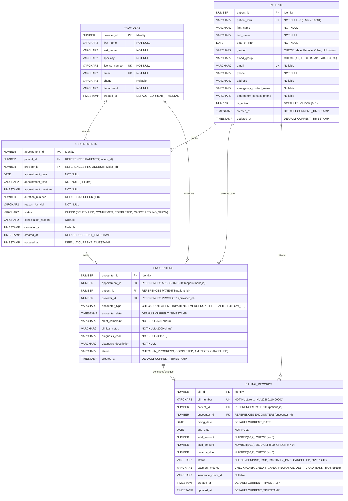

# Database Design & Relational Schema Specification

## 1. Overview

The **Healthcare Data Management and Analytics System** database is designed as a normalized, relational data store adhering to third normal form (3NF). It is engineered for **Oracle Database Free (23c / 21c)**, utilizing Oracle-native data types, sequence-backed identity columns, referential integrity foreign keys, CHECK constraints, and B-tree indexes.

The database tracks patient intake, provider credentialing, clinical consultations, medical diagnoses (ICD-10), and billing cycles.

---

## 2. Entity-Relationship Diagram (ERD)



---

## 3. Data Dictionary

### 3.1 Table: `PROVIDERS`
Stores licensed clinicians who conduct appointments and record clinical notes.

| Column | Data Type | Nullable | Constraints | Description |
| :--- | :--- | :--- | :--- | :--- |
| `provider_id` | NUMBER | NO | PK, Identity | Unique system identifier |
| `first_name` | VARCHAR2(50) | NO | | Provider's legal given name |
| `last_name` | VARCHAR2(50) | NO | | Provider's legal family name |
| `specialty` | VARCHAR2(100) | NO | | Clinical specialty (e.g. Cardiology) |
| `license_number` | VARCHAR2(50) | NO | UNIQUE | State or national medical license |
| `email` | VARCHAR2(100) | NO | UNIQUE | Professional email address |
| `phone` | VARCHAR2(20) | YES | | Department direct extension |
| `department` | VARCHAR2(50) | NO | | Clinical department division |
| `created_at` | TIMESTAMP | NO | DEFAULT CURRENT_TIMESTAMP | Audit creation timestamp |

### 3.2 Table: `PATIENTS`
Stores patient demographic, contact, and medical record identification.

| Column | Data Type | Nullable | Constraints | Description |
| :--- | :--- | :--- | :--- | :--- |
| `patient_id` | NUMBER | NO | PK, Identity | Internal primary key |
| `patient_mrn` | VARCHAR2(20) | NO | UNIQUE | Medical Record Number (`MRN-XXXXX`) |
| `first_name` | VARCHAR2(50) | NO | | Patient given name |
| `last_name` | VARCHAR2(50) | NO | | Patient family name |
| `date_of_birth`| DATE | NO | | Birth date (cannot be future) |
| `gender` | VARCHAR2(10) | NO | CHECK (`Male`,`Female`,`Other`,`Unknown`) | Biological or administrative gender |
| `blood_group` | VARCHAR2(5) | YES | CHECK (`A+`,`A-`,`B+`,`B-`,`AB+`,`AB-`,`O+`,`O-`) | ABO and Rh blood group |
| `email` | VARCHAR2(100) | YES | UNIQUE | Personal email address |
| `phone` | VARCHAR2(20) | NO | | Contact phone number |
| `address` | VARCHAR2(255) | YES | | Residential street address |
| `emergency_contact_name` | VARCHAR2(100) | YES | | Designated emergency contact |
| `emergency_contact_phone`| VARCHAR2(20) | YES | | Emergency contact telephone |
| `is_active` | NUMBER(1) | NO | DEFAULT 1, CHECK (`0`, `1`) | Soft-delete / active status flag |

### 3.3 Table: `APPOINTMENTS`
Manages scheduling and provider consultations.

| Column | Data Type | Nullable | Constraints | Description |
| :--- | :--- | :--- | :--- | :--- |
| `appointment_id` | NUMBER | NO | PK, Identity | Appointment sequence identifier |
| `patient_id` | NUMBER | NO | FK -> `PATIENTS.patient_id` | Scheduled patient |
| `provider_id` | NUMBER | NO | FK -> `PROVIDERS.provider_id` | Attending physician |
| `appointment_date` | DATE | NO | | Date of appointment |
| `appointment_time` | VARCHAR2(10) | NO | Format: `HH:MM` | Scheduled start time |
| `appointment_datetime` | TIMESTAMP | NO | UNIQUE with `provider_id` | Composite slot conflict prevention |
| `duration_minutes` | NUMBER | NO | DEFAULT 30, CHECK (> 0) | Expected consultation duration |
| `reason_for_visit` | VARCHAR2(255) | NO | | Patient's stated appointment reason |
| `status` | VARCHAR2(20) | NO | CHECK (`SCHEDULED`, `CONFIRMED`, `COMPLETED`, `CANCELLED`, `NO_SHOW`) | Current appointment state |
| `cancellation_reason` | VARCHAR2(255) | YES | Mandatory if status is CANCELLED | Audit rationale for cancellation |
| `cancelled_at` | TIMESTAMP | YES | | Cancellation timestamp |

### 3.4 Table: `ENCOUNTERS`
Documents clinical observations, examination findings, and ICD-10 diagnostic codes.

| Column | Data Type | Nullable | Constraints | Description |
| :--- | :--- | :--- | :--- | :--- |
| `encounter_id` | NUMBER | NO | PK, Identity | Encounter sequence identifier |
| `appointment_id` | NUMBER | YES | FK -> `APPOINTMENTS.appointment_id` | Linked scheduled appointment (optional for walk-ins) |
| `patient_id` | NUMBER | NO | FK -> `PATIENTS.patient_id` | Patient receiving care |
| `provider_id` | NUMBER | NO | FK -> `PROVIDERS.provider_id` | Attending provider |
| `encounter_type` | VARCHAR2(30) | NO | CHECK (`OUTPATIENT`, `INPATIENT`, `EMERGENCY`, `TELEHEALTH`, `FOLLOW_UP`) | Clinical setting |
| `encounter_date` | TIMESTAMP | NO | DEFAULT CURRENT_TIMESTAMP | Actual clinical examination time |
| `chief_complaint` | VARCHAR2(500) | NO | | Chief presenting symptom |
| `clinical_notes` | VARCHAR2(2000) | NO | | Physician's SOAP documentation |
| `diagnosis_code` | VARCHAR2(20) | NO | | Standard ICD-10 code (e.g. `I10`, `E11.9`) |
| `diagnosis_description`| VARCHAR2(255) | NO | | Plain-text diagnostic definition |
| `status` | VARCHAR2(20) | NO | CHECK (`IN_PROGRESS`, `COMPLETED`, `AMENDED`, `CANCELLED`) | Clinical documentation status |

### 3.5 Table: `BILLING_RECORDS`
Tracks financial charges, claims, payments, and balances.

| Column | Data Type | Nullable | Constraints | Description |
| :--- | :--- | :--- | :--- | :--- |
| `bill_id` | NUMBER | NO | PK, Identity | Unique billing record ID |
| `bill_number` | VARCHAR2(30) | NO | UNIQUE (`INV-YYYYMMDD-XXXXX`) | Human-readable invoice number |
| `patient_id` | NUMBER | NO | FK -> `PATIENTS.patient_id` | Responsible billing party |
| `encounter_id` | NUMBER | NO | FK -> `ENCOUNTERS.encounter_id` | Associated clinical visit |
| `billing_date` | DATE | NO | DEFAULT CURRENT_DATE | Invoice generation date |
| `due_date` | DATE | NO | | Invoice payment due date |
| `total_amount` | NUMBER(10,2) | NO | CHECK (>= 0) | Total charged amount |
| `paid_amount` | NUMBER(10,2) | NO | DEFAULT 0.00, CHECK (>= 0) | Cumulative payments received |
| `balance_due` | NUMBER(10,2) | NO | CHECK (>= 0) | Remaining unpaid balance |
| `status` | VARCHAR2(20) | NO | CHECK (`PENDING`, `PAID`, `PARTIALLY_PAID`, `CANCELLED`, `OVERDUE`) | Payment status |
| `payment_method` | VARCHAR2(30) | YES | CHECK (`CASH`, `CREDIT_CARD`, `INSURANCE`, `DEBIT_CARD`, `BANK_TRANSFER`) | Latest settlement method |

---

## 4. Integrity and Business Constraints

1. **Nonnegative Financial Amounts**:
   ```sql
   CONSTRAINT chk_bill_total_pos CHECK (total_amount >= 0),
   CONSTRAINT chk_bill_paid_pos CHECK (paid_amount >= 0),
   CONSTRAINT chk_bill_bal_pos CHECK (balance_due >= 0)
   ```
2. **Monetary Reconciliation Rule**:
   The database enforces that paid amount cannot exceed total billed amount, and balance due must strictly equal the difference:
   ```sql
   CONSTRAINT chk_bill_amounts CHECK (paid_amount <= total_amount AND balance_due = total_amount - paid_amount)
   ```
3. **Provider Schedule Conflict Prevention**:
   A composite unique constraint guarantees that a provider cannot be double-booked for the exact same start timestamp:
   ```sql
   CONSTRAINT uq_prov_slot UNIQUE (provider_id, appointment_datetime)
   ```
4. **Referential Integrity**:
   - `ON DELETE CASCADE` is applied to patient appointments, encounters, and billing records so that child operational records maintain referential consistency.
   - Deleting an appointment retains the clinical encounter by setting `appointment_id` to `NULL` (`ON DELETE SET NULL`), preserving medical legal records.

---

## 5. Performance Indexes

| Index Name | Table | Indexed Columns | Index Type | Query Optimization Target |
| :--- | :--- | :--- | :--- | :--- |
| `idx_patients_mrn` | `PATIENTS` | `patient_mrn` | B-Tree (Unique) | Exact match lookups during intake |
| `idx_patients_name` | `PATIENTS` | `last_name, first_name` | B-Tree | Patient directory name search & sorting |
| `idx_appointments_pat` | `APPOINTMENTS` | `patient_id` | B-Tree | Patient appointment history retrieval |
| `idx_appointments_prov_dt` | `APPOINTMENTS`| `provider_id, appointment_datetime` | B-Tree (Composite) | Schedule conflict check and daily clinician agenda |
| `idx_appointments_status` | `APPOINTMENTS`| `status` | B-Tree | Operational status filtering (Scheduled, Cancelled) |
| `idx_encounters_pat` | `ENCOUNTERS` | `patient_id` | B-Tree | Longitudinal patient history reports |
| `idx_encounters_prov` | `ENCOUNTERS` | `provider_id` | B-Tree | Provider workload and encounters count |
| `idx_billing_pat` | `BILLING_RECORDS` | `patient_id` | B-Tree | Patient balance and ledger lookups |
| `idx_billing_enc` | `BILLING_RECORDS` | `encounter_id` | B-Tree | 1-to-1 encounter billing association |
| `idx_billing_status_due` | `BILLING_RECORDS` | `status, due_date` | B-Tree (Composite) | Overdue aging report queries |
