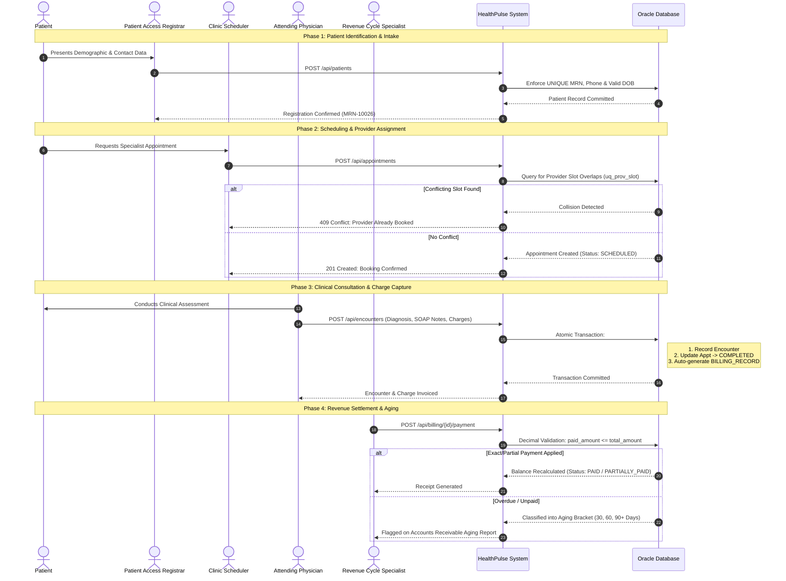

# Healthcare Workflows & Lifecycle Architecture

## 1. Overview

In healthcare operations, accurate record management and systematic lifecycle tracking ensure patient safety, regulatory compliance, continuity of care, and financial viability. This document outlines the end-to-end operational workflow simulated in this application—from initial patient intake to claim settlement—and compares this normalized model with enterprise clinical data architectures such as **Oracle Health Millennium (formerly Cerner Millennium)**.

---

## 2. End-to-End Healthcare Lifecycle Diagram

---

## 3. Workflow Stages & Data Validation Rules

### Stage 1: Patient Intake & Demographics
- **Objective**: Establish a single source of truth for patient identification.
- **Validations**:
  - `patient_mrn`: Medical Record Number generated as a unique institutional key.
  - `date_of_birth`: Verified to prevent future dates.
  - `gender`: Restricted to standardized administrative categories (`Male`, `Female`, `Other`, `Unknown`).
  - `email` & `phone`: Format-validated and checked for duplicate patient accounts.

### Stage 2: Appointment Scheduling
- **Objective**: Match patient care needs with qualified physician availability.
- **Validations**:
  - `date_time`: Booking must not occur in the past (unless back-entering historical paper charts).
  - `provider_availability`: Composite constraint checks `(provider_id, appointment_datetime)` to eliminate double-booking.
  - `cancellation_workflow`: An appointment may transition from `SCHEDULED` or `CONFIRMED` to `CANCELLED` only when accompanied by an audit reason. An already `COMPLETED` appointment cannot be retroactively cancelled.

### Stage 3: Clinical Encounter Documentation
- **Objective**: Capture medical assessment, clinical progress notes, and diagnostic coding.
- **Validations**:
  - `clinical_notes`: Physician progress notes are mandatory.
  - `diagnosis_code`: Encoded using standardized ICD-10 clinical classifications (e.g., `I10` for Hypertension, `E11.9` for Type 2 Diabetes).
  - `status_synchronization`: Documenting an encounter associated with a scheduled appointment atomically marks that appointment as `COMPLETED`.

### Stage 4: Charge Capture & Invoicing
- **Objective**: Convert clinical procedures into financial invoices.
- **Validations**:
  - `amount_checks`: Billed amount must be non-negative.
  - `1-to-1_linkage`: Prevents duplicate bill creation for the same clinical encounter.
  - `due_date_calculation`: Automatically initialized to NET 30 terms (`billing_date + 30 days`).

### Stage 5: Payment Processing & Accounts Receivable Aging
- **Objective**: Track collections and reconcile outstanding patient/payer balances.
- **Validations**:
  - `decimal_precision`: Financial operations use Python's `Decimal` type to prevent binary floating-point drift.
  - `overpayment_prevention`: A payment cannot exceed the remaining `balance_due`.
  - `aging_classification`: Invoices with unpaid balances past due are systematically segmented into aging brackets (`Current`, `1-30 Days`, `31-60 Days`, `61-90 Days`, `90+ Days Overdue`).

---

## 4. Educational Model vs. Oracle Health Millennium Data Model

It is vital to distinguish this educational application model from the production data model of **Oracle Health Millennium (formerly Cerner Millennium)**.

| Architecture Dimension | HealthPulse Educational System | Oracle Health Millennium (Cerner) |
| :--- | :--- | :--- |
| **Primary Relational Focus** | Normalized 3NF educational relational schema for clear SQL and reporting comprehension. | Highly generalized, extensible enterprise EAV (Entity-Attribute-Value) and code-value architecture. |
| **Patient Identification** | `PATIENTS` table with `patient_id` and `patient_mrn`. | `PERSON` table for person entities, linked to `PERSON_ALIAS` for multiple institutional MRNs, SSNs, and FIN numbers. |
| **Encounter Entity** | `ENCOUNTERS` table with direct provider and patient foreign keys. | `ENCOUNTER` table representing legal visit encounters, linked to `ENCNTR_ALIAS`, `ENCNTR_PRSNL_RELTN` (care team relationships). |
| **Controlled Terminology** | Plain-text strings and VARCHAR2 codes (`diagnosis_code`, `status`). | Standardized `CODE_VALUE` table mapped through `CODE_SET` (e.g. Code Set 71 for visit types, Code Set 400 for personnel relationships). |
| **Clinical Documentation** | `clinical_notes` stored in VARCHAR2/CLOB fields within `ENCOUNTERS`. | `CLINICAL_EVENT` table hierarchy (CE) storing structured discrete clinical observations, lab results, and document blobs. |
| **Financial / Charges** | `BILLING_RECORDS` table directly linked to encounters. | `CHARGE`, `BILL_ITEM`, and `PATIENT_BILLING` tables linked through charge services and pricing schedules. |
| **Query Dialects** | Standard ANSI SQL, Oracle SQL, and PL/SQL. | Oracle SQL, PL/SQL, and proprietary **Cerner Command Language (CCL)** used with Discern Explorer. |

> [!NOTE]
> This educational system is designed to simulate authentic hospital workflows, transaction controls, and operational metrics while remaining completely self-contained and reproducible on standard relational database engines.
